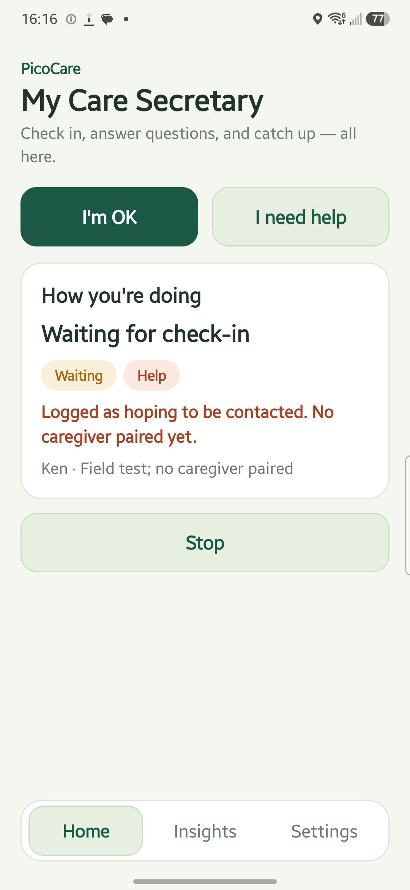
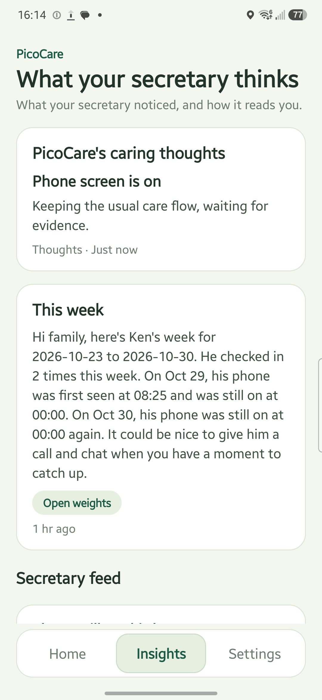
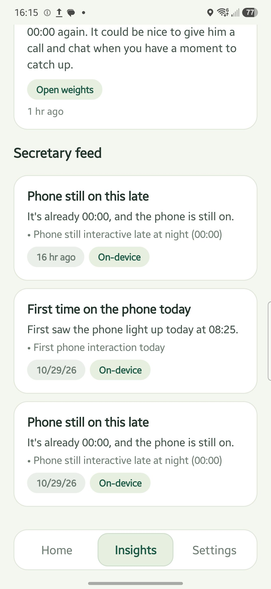
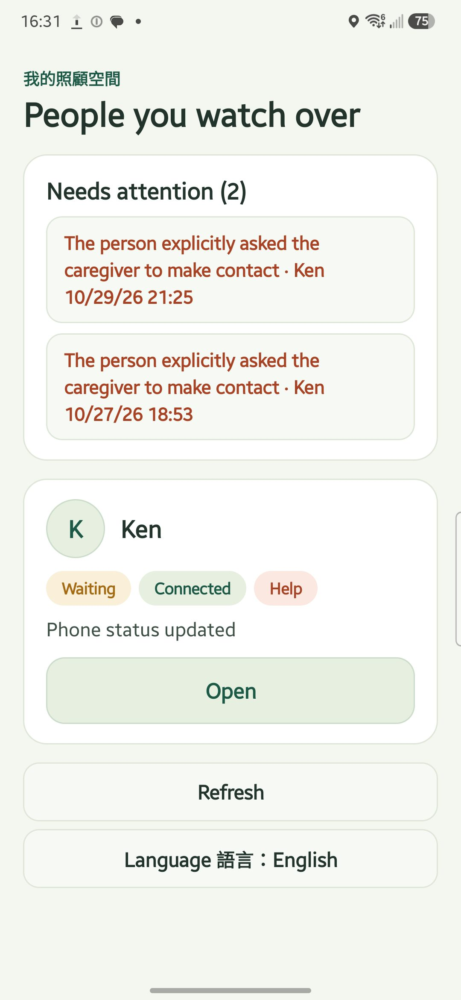
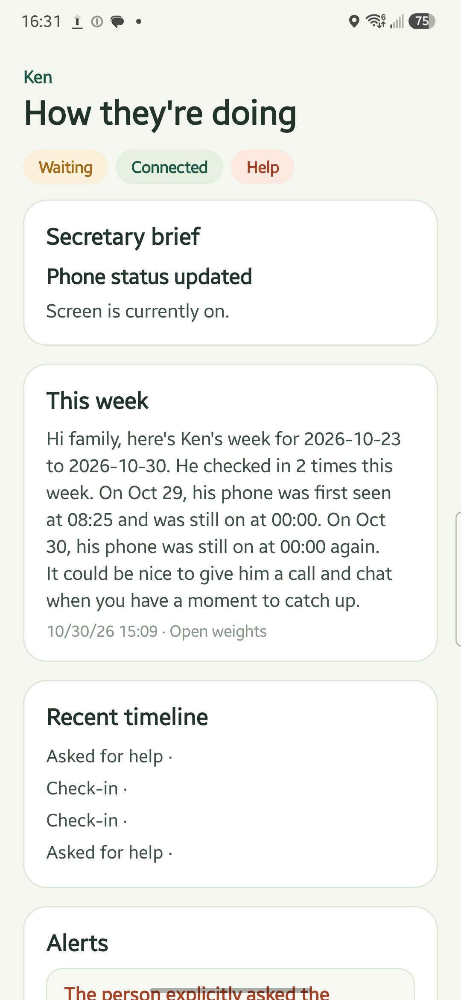
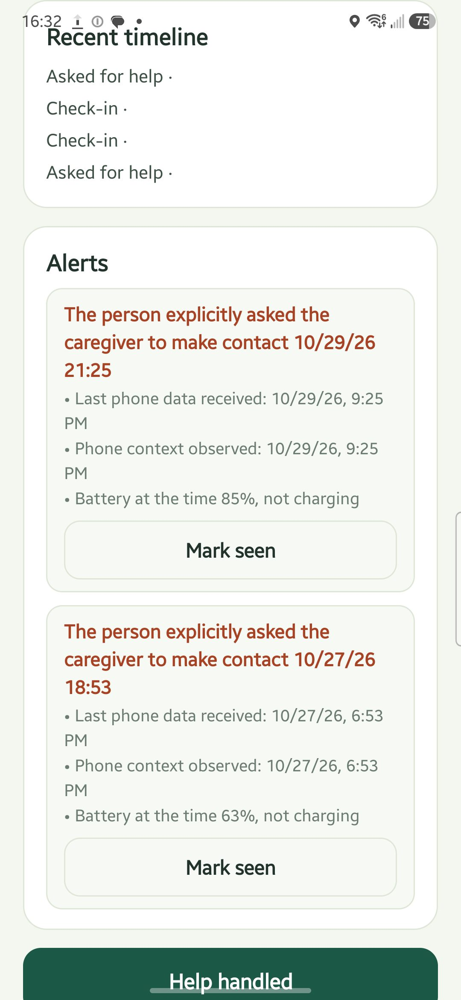
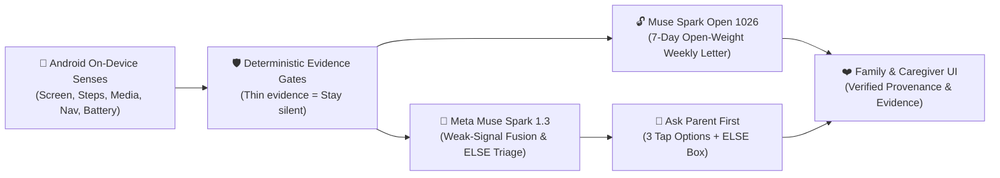

# PicoCare

### *The phone watches quietly. The secretary thinks with Meta. The family finally rests easy.*

> **Meta Global AI Developer Hackathon 2026** · **Indie Developer Track** · *Build for Your World* & *Best Use of Open Weights*


**🎬 Demo video (1:49, English, real Galaxy S23 footage): https://www.youtube.com/watch?v=8saCgnKm5GU**

---

## The Silence Between Two Homes

There is a specific kind of silence that makes an adult child’s heart race.

It is 7:30 in the evening. You are at your desk in another city. Your aging mother or father lives alone, and your family chat thread hasn’t moved since yesterday morning. You stare at your phone, caught in a quiet ache that millions of families know by heart: *Should I call again and sound like I’m checking up on them? Or are they just resting?*

When families look for technology to bridge that distance, they are forced into a cruel choice:

- **Indoor cameras** trade away a parent’s dignity—turning the living room where they raised you into a glass cage.
- **Rigid check-in alarms** turn love into a daily roll call—demanding a tap at 9:00 AM sharp, and triggering false panic simply because your father was absorbed in an old movie or left his phone on the kitchen table.

We built **PicoCare** because we believe **care should never feel like surveillance, and love should never sound like an alarm.**

PicoCare gives an aging parent their own **personal care secretary** (`tw.picocare.meta`), paired with a companion app for their family or care team (`tw.picocare.meta.care`). Instead of watching through a lens, the phone listens only to the gentle rhythm of everyday life—screen wakes, morning steps, media playback, navigation cues, and overnight charging. When a day’s rhythm shifts in a way worth checking, the secretary **asks the parent first**—with simple tap options, never an overwhelming chatbot—and only reaches out to the family when things remain unclear.

It never diagnoses illness. It never gives medical advice. It never cries wolf.  
It simply keeps a warm, honest thread between the people who love each other most.

---

## Live From the Field — Real Galaxy S23 Footage

Everything below is captured from live field testing on a **Samsung Galaxy S23** running real multi-day telemetry, paired with our **Meta Muse Spark** and **Open-Weight** backend. Every screen is bilingual (**English** by default, one tap to **繁體中文**).

### 1. On the Parent’s Phone (`tw.picocare.meta`)

| One-Tap Autonomy | Weekly Reflection & AI Insight | Evidence-Backed Secretary Feed |
| :---: | :---: | :---: |
|  |  |  |
| **No menus. No chatbot maze.**<br/>One tap to say *"I'm Okay Today"* or *"Need Help"*, plus a calm card when the secretary asks a single multiple-choice check-in question. | **Open-Weight Weekly Review.**<br/>`muse-spark-open-1026` reads 7 days of rhythm and writes a warm summary—explicitly badged with its model provenance (`Open weights`). | **Every word cites its timestamp.**<br/>From `08:25 AM` screen & step cues to `00:00 AM` overnight charging, every note shows the exact on-device evidence behind it. |

### 2. On the Family Caregiver’s Phone (`tw.picocare.meta.care`)

| Peace of Mind at a Glance | Shared Context, Zero Spying | Gentle Human Follow-Up |
| :---: | :---: | :---: |
|  |  |  |
| **Who is fine, who needs a call.**<br/>Supports both 1-on-1 family care and 1-to-many care organizations in one calm priority list. | **The parent’s own words come first.**<br/>See the weekly summary, the secretary’s latest reading, the cited evidence, and what your parent actually replied. | **Close the loop with warmth.**<br/>Log a quick phone call, send a gentle check-in question, or resolve a help request without overwriting history. |

---

## Why Meta AI & Open Weights Are Irreplaceable Here

A deterministic rule engine alone cannot care for a human being. Rigid thresholds either stay blind to subtle trouble or drown a family in false alerts the moment a parent takes a long nap.

Yet an unconstrained LLM is equally dangerous in elder care: left alone, models hallucinate causes, invent medical diagnoses, or overreact to a single missing sensor sample.

**PicoCare solves this by pairing local deterministic evidence gates with three specialized Meta AI jobs:**



| Secretary Role | Model & Pathway | Why Only Meta Can Do This |
| :--- | :--- | :--- |
| **1. Weekly Family Letter**<br/>*(Open Weights Track)* | **`meta-models/muse-spark-open-1026`**<br/>*(via Baseten Open-Weight API, automatic fallback to `muse-spark-1.3`)* | Reads 7 days of daily observations, check-ins, and answers, then distills them into a warm, human `≤400`-character narrative for the family. The UI explicitly badges **`Open weights`** vs **`Meta`** so families always know which model wrote the reflection. |
| **2. Weak-Signal Situation Fusion** | **`muse-spark-1.3`**<br/>*(Meta Official API · Structured JSON Output)* | Fuses subtle multi-sensor clues—such as *1,779m of movement + 9 repeated navigation prompts + draining battery*—into one natural, respectful check-in question when rigid single-sensor rules would miss the pattern. |
| **3. Nuanced `ELSE` Free-Text Triage** | **`muse-spark-1.3`**<br/>*(Meta Official API · Low-Latency Reasoning)* | When a parent taps *"None of the above"* (`ELSE`) and writes in their own words (*"Just taking a walk nearby, I'm fine"*), Meta judges whether the concern is **`clarified`** (automatically retracting pending caregiver alerts while preserving the parent's exact words), **`needs_contact`**, or **`pending`**. |

### Four Unbreakable Guardrails

1. **Zero Raw PII to the Model**: Exact GPS coordinates, app package names, and raw private notification texts are **never** sent to the LLM by default—only aggregated distances, counts, category labels, and timestamps.
2. **Verified Evidence Citations**: Every `muse-spark-1.3` reading must cite real `evidenceIds` from the current sample window. If a model output cites a non-existent ID, violates JSON schema, or arrives after the phone's state has already changed, it is discarded immediately.
3. **Two-Signal Minimum for Proactive Check-Ins**: Meta can propose a proactive check-in (`outing/confirm` or `video/wait`), but only when backed by **at least two distinct pieces of evidence**, including at least one fresh observation. Thin evidence means respectful silence.
4. **Strict Non-Medical Boundary**: Every output from both `muse-spark-1.3` and `muse-spark-open-1026` passes a deterministic medical/diagnostic filter before storage or display. No "does not mean" boilerplate disclaimers, no fabricated alternative guesses, and zero medical advice.

---

## Two Moments Where PicoCare Changes Everything

### Moment 1: Lost in an Afternoon Movie *(Preventing False Panic)*
At 2:00 PM, your father hasn’t tapped his daily check-in. An ordinary check-in app would blast an overdue alarm to your phone while you’re in a meeting.  
PicoCare’s on-device collector notices continuous foreground media playback and active audio sessions. The secretary recognizes he is simply enjoying a video, quietly postpones the check-in prompt, and logs the observation transparently—letting him finish his movie in peace.

### Moment 2: The Unfamiliar Evening Walk *(Catching Subtle Trouble Early)*
At 5:40 PM, your mother is out walking. Her battery isn't critically low yet (`80%`), so a basic battery alert wouldn't fire. But PicoCare aggregates **`1,779 meters` of movement**, **repeated location revisits**, and **`9` consecutive navigation notifications**.  
`muse-spark-1.3` fuses those weak signals and gently asks her on her screen first:
> *"Looks like you're out and moving around — is everything going smoothly?"*
> - `[ Everything is fine ]`
> - `[ Busy right now, I'll reply later ]`
> - `[ Please have my caregiver contact me ]`
> - `[ None of the above (Write a short note) ]`

If she taps *"Everything is fine"* or types *"Running into an old friend at the market"*, `muse-spark-1.3` marks the situation `clarified` and updates the family feed warmly. Only if she asks for help—or if the question goes unanswered—does PicoCare escalate to you, complete with the timestamped trail and what was asked.

---

## Engineering Under the Hood

Built from the ground up during the hackathon (**Oct 26–30, 2026**) with production-grade discipline:

- **Zero Runtime Dependencies on the Backend**: Pure **TypeScript + Node.js (`24.12+`)** and built-in **SQLite**, sharing a strict end-to-end contract (`shared/protocol.ts`) with the web and Android clients.
- **Two Native Kotlin Android Apps**: Built from a single codebase (`android/`) with two flavors—`tw.picocare.meta` (Elder) and `tw.picocare.meta.care` (Caregiver)—featuring a transactional **7-day on-device SQLite evidence timeline** and an offline-resilient, idempotent pending outbox that prioritizes help requests and answers over background telemetry when connectivity returns.
- **Floating Greeting Schedule with Cooldown**: No robotic 9:00 AM alarms. The secretary picks a natural moment when the parent is already using their phone, enforces an **8-hour cooldown** between questions, respects **quiet hours (`22:00–07:00`)**, and falls back to a gentle `20:00` evening check only if the phone has been completely silent all day.
- **160 Automated Tests Green**:
  - **94 / 94 Node.js & TypeScript tests** covering real HTTP roundtrips, SQLite persistence, floating schedules, `muse-spark-1.3` wild-2 hypothesis gating, `ELSE` free-text retraction, and `muse-spark-open-1026` Baseten open-weight fallback.
  - **66 / 66 Android JVM & Robolectric unit tests** (`33` per flavor) covering navigation retention, location accuracy filtering, offline outbox replay, and schema migrations, with **0 Lint errors**.

---

## Run It Yourself

### 1. Backend & Web Console (Node.js 24.12+)

```powershell
npm install
npm run check     # TypeScript strict typecheck (clean)
npm test          # 94/94 automated test suite
npm run build
npm start -- --demo
```

Open **<http://127.0.0.1:4317>** to explore the interactive web console, create a care workspace, or spin up a synthetic demo timeline immediately.

### 2. Enable Live Meta Muse Spark & Open Weights

Copy `.env.example` to `.env.local` (git-ignored; keys are never logged or bundled into APKs):

```ini
PICOCARE_META_ENABLED=true
MODEL_API_KEY=your_meta_api_key_here
PICOCARE_META_MODEL=muse-spark-1.3

# Optional: Baseten Open-Weight pathway for 7-day Weekly Reflections
BASENTEN_API_KEY=your_baseten_api_key_here
BASENTEN_MODEL=meta-models/muse-spark-open-1026
```

Verify live model connectivity and start the server:

```powershell
npm run meta:check   # Runs 1 synthetic evidence check against the live Meta API
npm run start:meta   # Starts PicoCare with live Meta Muse Spark + Open Weights
```

### 3. Build the Android Apps (JDK 17 · Android SDK 35 · Gradle 8.13)

```powershell
# Run Android Lint + 33 unit tests per flavor
.\scripts\build-android.ps1 -Offline

# Build Elder Secretary APK (tw.picocare.meta) & Caregiver APK (tw.picocare.meta.care)
.\scripts\build-field.ps1 -OutputDirectory .local/apks -Flavor elder
.\scripts\build-field.ps1 -OutputDirectory .local/apks -Flavor care
```

---

## Repository Map & Verification Trail

- **[`docs/build-log.md`](docs/build-log.md)** — Day-by-day engineering log (Oct 26–30, 2026) mapping every commit, model benchmark, and field test.
- **[`docs/pitch.md`](docs/pitch.md)** — Concise judge summary & submission kit.
- **[`META.md`](META.md)** — Detailed architecture, token benchmarks (`muse-spark-1.3` vs `muse-wonder-1.0`), wild-2 hypothesis gating, and Baseten `muse-spark-open-1026` integration notes.
- **[`PRODUCT.md`](PRODUCT.md)** & **[`SECRETARY.md`](SECRETARY.md)** — Product boundaries, scenario state machines, and non-medical safety contracts.
- **[`FIELD.md`](FIELD.md)** & **[`README_ZH.md`](README_ZH.md)** — Real-device field testing guide and Traditional Chinese documentation.

---

<div align="center">
  <b>PicoCare</b> · <i>No medical advice. No false alarms. Only care.</i><br/>
  Built with ❤️ using <b>Meta Muse Spark 1.3</b> & <b>Muse Spark Open 1026</b>
</div>
